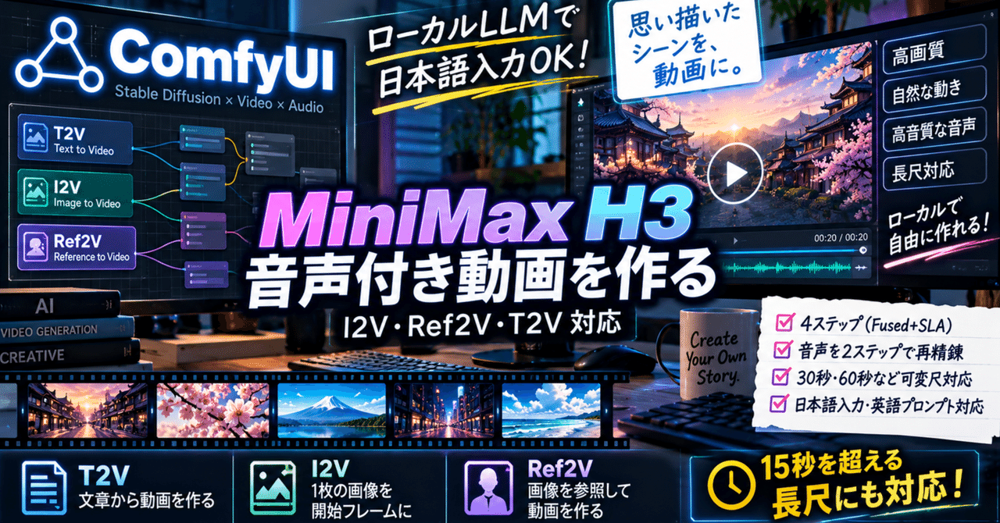
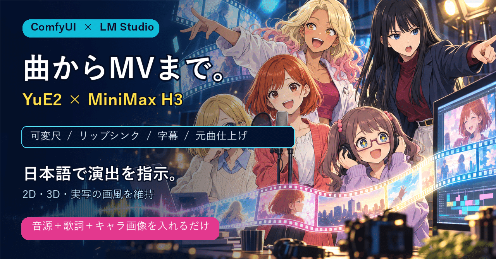
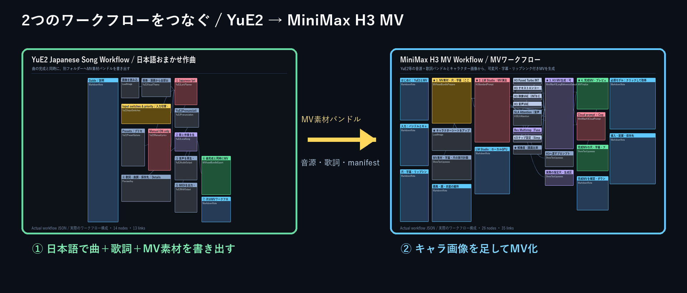
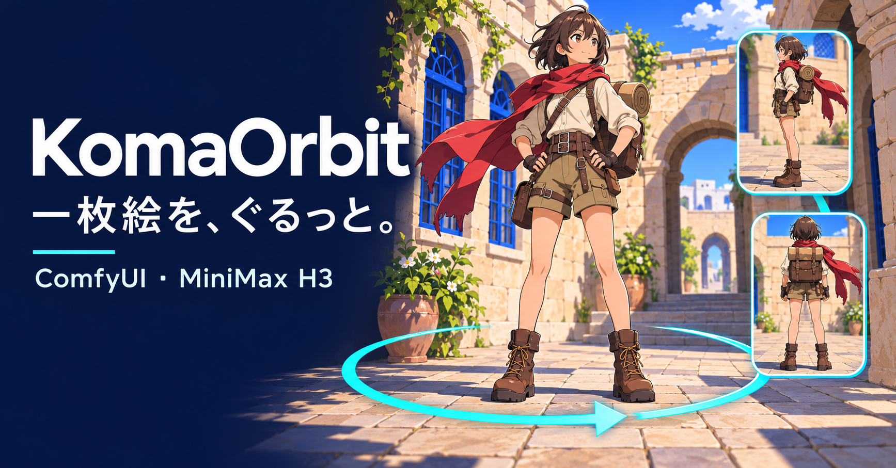

# ComfyUI workflows / ComfyUIワークフロー案内
<!-- bilingual-readme: paired english-japanese -->

Choose what you want to make. There are **three independent ZIP packages**; you do not need every workflow in this repository. / 作りたいものから選んでください。配布は **3種類の独立したZIP** です。同じGitHubに置いていますが、全部を導入する必要はありません。

## Choose your package / 必要な配布物を選ぶ

| Package / 配布物 | Input → result / 入力と結果 | Download / 入手先 |
|---|---|---|
| **H3 Video**: T2V / I2V / Ref2V | Text or images → video with audio / 文章・画像から音声付き動画 | [動画3方式のZIP / Video ZIP](https://github.com/FURUYAN1234/comfyui-h3-workflows/releases/download/h3-split-20261114072010/H3_Video_20261114072010_v1.2.2.zip) |
| **H3 MV** | Song + lyrics + character sheet → MV / 完成曲・歌詞・キャラ画像からMV | [MV専用ZIP / MV ZIP](https://github.com/FURUYAN1234/comfyui-h3-workflows/releases/download/h3-split-20261114072010/H3_MV_20261114072010_v1.2.2.zip) |
| **KomaOrbit** | Illustration → camera control and PNG / 一枚絵の構図を動かしてPNG保存 | [KomaOrbit専用ZIP / KomaOrbit ZIP](https://github.com/FURUYAN1234/comfyui-h3-workflows/releases/download/komaorbit-20261105183001/KomaOrbit_20261105183001.zip) |

Each ZIP includes its custom-node source, instructions, model URLs, integrity checks and notices. Models and user inputs are separate. / 各ZIPに必要なノードのソース、説明書、モデル取得先、検査ファイル、権利表示を含みます。モデル本体と入力素材は別途用意します。

## H3 Video — three ways to make video / 動画を作る3方式

**[Open the H3 Video guide / H3 Videoの案内ページを開く →](https://furuyan1234.github.io/comfyui-h3-workflows/h3-video/demo/)**

[H3 Video on note / 動画3方式のnote解説](https://note.com/happy_duck780/n/n15e732b3147b)

### T2V — text to video / 文章から動画

Write a scene and optional dialogue. No image is needed. Open the T2V JSON in **H3 Video**. / 場面や必要な台詞を書いて動画を作ります。画像は不要です。**H3 Video** ZIP内のT2V用JSONを開きます。

**[T2V: installation, inputs, first run and output / T2Vの使い方](docs/h3/t2v/README.md)**

### I2V — animate a starting image / 開始画像を動かす

Upload one starting image and describe its movement. The image anchors the opening frame. Open the I2V JSON in **H3 Video**. / 開始画像を1枚入れ、動きを指示します。その画像を起点とする動画です。**H3 Video** ZIP内のI2V用JSONを開きます。

**[I2V: installation, inputs, first run and output / I2Vの使い方](docs/h3/i2v/README.md)**

### Ref2V — generate from references / 参照画像から動画

Use one to five references for characters, clothes, objects or places. These guide appearance without fixing the first frame. Open the Ref2V JSON in **H3 Video**. / 1～5枚で人物・衣装・物体・場所を指定します。開始フレームを固定するI2Vとは使い方が異なります。**H3 Video** ZIP内のRef2V用JSONを開きます。

**[Ref2V: installation, inputs, first run and output / Ref2Vの使い方](docs/h3/ref2v/README.md)**

## MV — finished song to music video / 完成曲をMVにする

**[Open the H3 MV guide / H3 MVの案内ページを開く →](https://furuyan1234.github.io/comfyui-h3-workflows/h3-mv/demo/)**

Use **H3 MV** with a song bundle, exact lyrics and a character sheet. It generates visuals, restores the original song and adds optional subtitles and fades. / **H3 MV** ZIPへ完成音源バンドル・正確な歌詞・キャラクターシートを入力し、映像生成後に元音源、必要なら字幕とフェードを合成します。

**[MV: installation, inputs, first run and output / MVの使い方](docs/h3/mv/README.md)** · [MV note article / note解説](https://note.com/happy_duck780/n/ne8a84cb6db37)

## KomaOrbit — illustration to 3D composition / 一枚絵から3Dで構図を探す

**[Open the KomaOrbit guide / KomaOrbitの案内ページを開く →](https://furuyan1234.github.io/comfyui-h3-workflows/komaorbit/demo/)**

Use only **KomaOrbit**. Create a fixed 3D subject and inferred environment, move the camera with the mouse, and save a PNG at the original dimensions. This cover is a concept illustration; the guide shows the actual workflow and test input. / **KomaOrbit** ZIPだけで導入します。一枚絵から固定3Dの人物と補完背景を生成し、マウスで構図を決めて元画像寸法のPNGへ保存します。上は紹介用イラストで、ガイドには実ワークフローと検証入力を掲載しています。

**[KomaOrbit illustrated guide / 図入りの使い方と導入](docs/komaorbit/README.md)** · [note article / note記事](https://note.com/happy_duck780/n/n3f68482d5edd) · [Usage page / 操作ページ](https://furuyan1234.github.io/comfyui-h3-workflows/komaorbit/demo/)

## ZIP contents / ZIPの内容と重複の扱い

| ZIP | Workflow JSONs / JSON本数 | Custom-node folders / ノード | Other ZIPs required? / 他のZIPは必要？ |
|---|---:|---:|---|
| H3 Video | 3: T2V, I2V, Ref2V | 5 shared packages / 共通5種 | No / 不要 |
| H3 MV | 1: MV | Same 5 + MV adapter / 共通5種＋MV専用1種 | No / 不要 |
| KomaOrbit | 1: KomaOrbit | 3 separate packages / 専用3種 | No / 不要 |

When using H3 Video and MV together, install their identical shared folders only once. KomaOrbit has its own installer and model list. / 動画3方式とMVを両方使う場合、共通ノードを二重配置せず1組だけ使います。KomaOrbitは導入スクリプトとモデル一覧が別です。

## Versions and terms / 版と利用条件

H3 guides describe **v1.2.2**. Workflow inputs, selected models and four video steps are retained while the shared LM connection and visual inspection are repaired; separately discussed Comfy Kitchen Attention experiments are not included. Older releases remain available. / H3の各ガイドは **v1.2.2** を説明します。入力方式・選択モデル・映像4ステップを維持し、共通のLM接続と画像検査を修正しました。別途紹介したComfy Kitchen Attentionの実験設定は追加していません。旧版ZIPは履歴として残します。

[H3 setup / H3共通導入](docs/h3/SETUP.md) · [Settings and recovery / 設定と再開](docs/h3/SETTINGS.md) · [Validation / 検証記録](VALIDATION.md) · [H3 note article / H3解説](https://note.com/happy_duck780/n/n15e732b3147b)

[Usage guide / 利用案内](FURU_TERMS.md) · [License scope / 適用条件](LICENSE_SCOPE.md) · [H3 notices / H3権利表示](LICENSES_AND_NOTICES.md) · [KomaOrbit notices / KomaOrbit権利表示](docs/komaorbit/THIRD_PARTY_NOTICES.md). Source licenses grant no extra model/output rights. / ソースのライセンスがモデルや生成物に追加の権利を与えるものではありません。

## Changes in v1.2.2 / v1.2.2の変更点

- Restores the bundled LM Studio schema and client; a clean kit no longer needs private Qwen nodes. Start LM Studio and load your chosen vision model manually. / 同梱スキーマとLM Studioクライアントを再接続し、非同梱の個人用Qwenノードへの依存を解消しました。LM Studioと選択した画像対応モデルは手動で起動します。
- Recognizes screen-text bans without inventing speech. / 「画面文字なし」などの指定を発話要求と取り違えないよう修正しました。
- Confirms suspected action replay using ordered action phases; checks every suspected duplicate frame independently. One clarification is allowed for uncertain visibility. Unresolved evidence stays unavailable and cannot authorize a defect-based rerender. / 動作のやり直し疑義を時系列の動作段階で確認し、人物重複の疑義は該当する全フレームを個別確認します。不確かな場合の再確認は1回までとし、未確定は検査不能として保持し、欠陥を根拠にした再生成へ進めません。
- Shared repairs apply to H3 Video and MV. KomaOrbit is unchanged. / 共通修正はH3 VideoとMVに適用し、KomaOrbitは変更していません。
