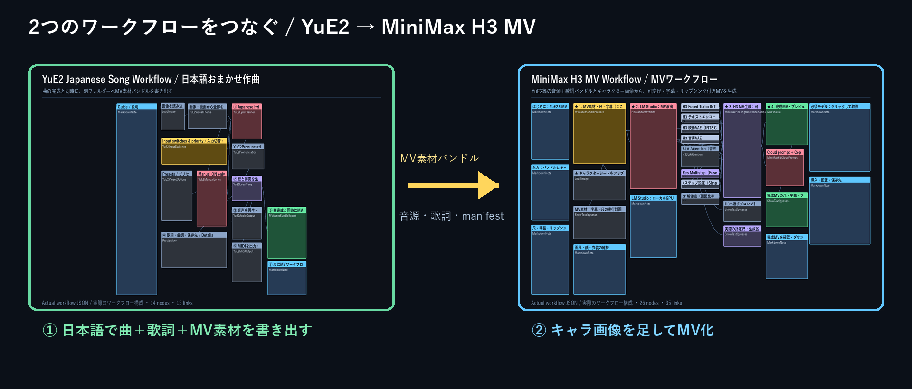
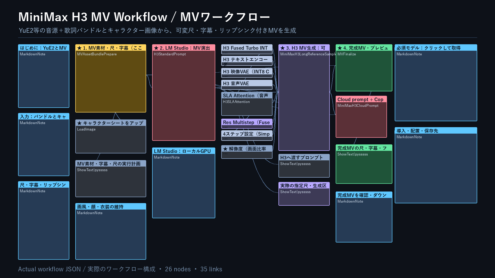

# MV — music video from a finished song / 完成曲からMVを作る
<!-- bilingual-readme: paired english-japanese -->

[](https://furuyan1234.github.io/comfyui-h3-workflows/h3-mv/demo/)

**[Open the H3 MV guide / H3 MVの案内ページを開く →](https://furuyan1234.github.io/comfyui-h3-workflows/h3-mv/demo/)**

Provide a completed song, exact lyrics and a character sheet. This workflow generates visuals and restores your original song in the final MP4, with optional timed subtitles, title, link and fades. It does not compose the song. / 完成音源・正確な歌詞・キャラクターシートから映像を作り、最終MP4には元曲を戻します。字幕、タイトル、終了リンク、フェードにも対応します。作曲するワークフローではありません。



## Download / 入手先

[Download H3_MV_20261105183000_v1.2.1.zip / MV専用ZIPを取得](https://github.com/FURUYAN1234/comfyui-h3-workflows/releases/download/h3-split-20261105183000/H3_MV_20261105183000_v1.2.1.zip). It contains only **MV_H3_YuE2-LMStudio_v1.2.1.json** and its six custom-node packages. The T2V/I2V/Ref2V and KomaOrbit packages are not required. / JSONは **MV_H3_YuE2-LMStudio_v1.2.1.json** の1本だけで、必要な6ノードパッケージを同梱します。動画3方式やKomaOrbitのZIPは不要です。

[Workflow JSON only / 導入済みの方向けJSON単体](https://raw.githubusercontent.com/FURUYAN1234/comfyui-h3-workflows/main/workflows/MV_H3_YuE2-LMStudio_v1.2.1.json)

## Requirements and installation / 必要な環境と導入

H3-capable ComfyUI, CUDA PyTorch, matching Triton, FFmpeg/ffprobe, LM Studio with a vision model and H3’s four model files are required. Local Whisper in Transformers format provides subtitle alignment. WSL2 with RTX 5080 16GB was tested; native Windows GPU and macOS are unverified. / H3対応ComfyUI、CUDA版PyTorch、対応Triton、FFmpeg／ffprobe、画像対応LM Studio、H3用4モデルが必要です。字幕の時刻合わせはTransformers形式のローカルWhisperを使います。検証環境はWSL2・RTX 5080 16GBで、WindowsネイティブGPUとmacOSは未検証です。

1. Extract the MV ZIP; run `python -B verify_package.py`. / MV専用ZIPを展開し、検査します。
2. Copy its six custom-node folders into ComfyUI’s `custom_nodes/`, backing up old same-named folders first. / 同梱6フォルダーを配置します。同名の旧版は先にComfyUI外へ退避します。
3. Use ComfyUI’s Python for `python -m pip install -r requirements.txt`. Obtain the four models in `models.json`. / ComfyUI用Pythonで依存ライブラリを入れ、モデル一覧の4ファイルを取得します。
4. Follow the included `docs/h3/SETUP.md` for LM Studio and Whisper, then restart ComfyUI. / 同梱の共通導入でLM StudioとWhisperを設定し、再起動します。

[Detailed setup / 詳しい共通導入](https://github.com/FURUYAN1234/comfyui-h3-workflows/blob/main/docs/h3/SETUP.md)

## Inputs / 入力素材

Use a YuE2 v1.6.1 schema-v2 bundle for 1–12 characters with stable IDs. Views and expressions of the same person remain one character. Unknown singer assignments are not guessed from timbre. / YuE2 v1.6.1のschema-v2バンドルでは1～12人を安定ID付きで扱います。同じ人物の別角度や表情差分は別人に数えず、指定のない歌唱者を声質から推測しません。

## Create a music video from YuE2 or another singing system / YuE2等の曲からMVを作る



1. In [ComfyUI-YuE2-Japanese v1.6.1](https://github.com/FURUYAN1234/ComfyUI-YuE2-Japanese/releases/tag/v1.6.1), generate a song. The YuE2 final song-export node creates `ComfyUI/output/mv-assets/TITLE_TIMESTAMP_ID/` at the same time as the normal song folder. / [ComfyUI-YuE2-Japanese v1.6.1](https://github.com/FURUYAN1234/ComfyUI-YuE2-Japanese/releases/tag/v1.6.1)で曲を生成します。通常の曲フォルダーと同じ実行で、YuE2の完成曲を書き出すノードが `ComfyUI/output/mv-assets/曲名_日時_ID/` を別途作ります。
2. Open `workflows/MV_H3_YuE2-LMStudio_v1.2.1.json`. Enter that relative folder as `mv-assets/TITLE_TIMESTAMP_ID`; an absolute path is not required. / `workflows/MV_H3_YuE2-LMStudio_v1.2.1.json` を開き、`mv-assets/曲名_日時_ID` の相対名を入力します。絶対パスは不要です。
3. Upload one character sheet with the standard `LoadImage` node. Use a clean reference that shows the intended face, hair, body proportions, and clothing. / 標準 `LoadImage` へキャラクターシートを1枚アップロードします。顔・髪・体格・服装が分かる参照を使います。
4. In the large Japanese direction field, describe the mood or write “お任せ”. The bundled rules ask LM Studio to retain the input's 2D anime, 3D, or live-action appearance and avoid unauthorized redesign. / 大きな日本語欄へMVの雰囲気を書くか「お任せ」と入力します。同梱ルールは入力が2Dアニメ・3D・実写のどれかを維持し、勝手な別デザイン化を避けるよう指示します。
5. Select `任意秒数` for a short test such as 20 seconds, or `音源末尾まで（可変尺）` for a complete song. `start_seconds` can begin from another section. / 20秒等の検証は `任意秒数`、1曲完走は `音源末尾まで（可変尺）` を選びます。`start_seconds` で途中からも開始できます。
6. For subtitles, enable alignment and point `whisper_model_path` to a Transformers-format Whisper folder, normally `models/whisper/whisper-large-v3-turbo`. The exporter intentionally does not invent timestamps; it passes exact lyrics with `timing_status: not_aligned`, and this node aligns them to the final master audio. / 字幕を使う場合は時刻合わせをONにし、`whisper_model_path` へTransformers形式Whisperを指定します。標準は `models/whisper/whisper-large-v3-turbo` です。書き出し側は時刻を捏造せず `timing_status: not_aligned` で正確な歌詞を渡し、このノードが最終音源へ合わせます。
7. Queue the workflow. The final node restores the original song audio, burns subtitles when enabled, overlays a top-left title that fades out, adds the configured link at the lower right near the end, and fades picture and sound together. The node preview includes ComfyUI's normal download control. / 実行すると、最後のノードが元曲音声へ戻し、必要なら字幕を焼き込み、左上タイトルをフェードアウト、終盤に右下リンクを重ね、映像と音声を同時にフェードします。最終ノードのプレビューから通常どおりダウンロードできます。

For a multi-character sheet without an explicit singer assignment, the workflow never guesses the singer from voice timbre. Whisper timing drives exact subtitles in the final renderer, while H3 receives vocal-activity windows and `<Audio 1>` without lyric text; exactly one visible registered subject is animated per solo window. / 歌唱者が明示されていない複数キャラシートでは、声質から人物を推測しません。Whisper時刻と正確な歌詞は最終字幕へ使い、H3へは歌詞本文を渡さず歌唱区間と `<Audio 1>` だけを渡し、ソロ区間では登録済み人物1人だけを動かします。

Bundle contract / バンドル仕様:

```text
ComfyUI/output/mv-assets/TITLE_TIMESTAMP_ID/
├─ master.flac            # final uncut source song / 最終元曲
├─ lyrics_display.txt     # exact display lyrics / 表示用歌詞
├─ lyrics_singing.txt     # readings used for singing / 歌唱用読み
├─ lyrics.json            # machine-readable lyrics / 機械可読歌詞
├─ mv_manifest.json       # schema, hashes and timing status / 仕様・ハッシュ・時刻状態
└─ README.txt
```

Other singing systems can use the same MV workflow by producing this contract, or by connecting a compatible exporter that accepts standard ComfyUI `AUDIO` and metadata. / 他の歌声システムでも同じバンドル仕様を出すか、標準ComfyUI `AUDIO` とメタデータを受ける互換書き出しノードへ接続すれば再利用できます。

The visual reference is guidance, not a face-lock guarantee. If the face, hairstyle, or clothing drifts, improve the sheet, shorten the shot, or regenerate the affected segment; do not treat one successful sample as a universal identity guarantee. / キャラクター画像は参照誘導であり、顔固定の保証ではありません。顔・髪・服が崩れた場合は、シート改善、カット短縮、該当区間の再生成で確認してください。単一サンプルの成功を全素材の保証にはしません。


## Outputs and review / 出力と確認

Start with 20 seconds and a 1-second fade. Watch the complete MP4, checking character identity, mouth movement, exact subtitle text/timing and original audio. Then select **音源末尾まで（可変尺）** for a full song. / 初回は20秒・フェード1秒で試します。人物、口の動き、字幕全文と時刻、元曲を通して確認し、問題がなければ **音源末尾まで（可変尺）** に切り替えます。

Final file: `ComfyUI/output/video/MV/<title_timestamp>/final.mp4`. Segment cache: `ComfyUI/output/h3_long_video/`. Keep the cache until completion. / 完成動画と区間キャッシュは左記です。完了前にキャッシュを削除しないでください。

## Limits and validation / 制約と検証

The recorded v1.2.1 normal-path test used a two-character bundle, generated five H3 segments and produced a 60.000-second 864×480 24fps MP4 with four subtitle intervals and restored original audio. This packaging revision does not claim a new song generation. Exact identity and lip sync are not guaranteed for every input. / 記録済みのv1.2.1検証は2人物バンドルからH3の5区間を生成し、60.000秒・864×480・24fps、字幕4区間、元音源を確認したものです。今回の配布整理で新たな曲を生成したという意味ではありません。全入力での人物一致や口の同期は保証できません。

Missing bundle files or wrong hashes stop preparation. Check the selected bundle and original sheet. For missing subtitles, check the Whisper path and alignment. / バンドル欠落やハッシュ不一致は準備段階で停止します。素材フォルダーと元のシートを確認してください。字幕が出ない場合はWhisperのパスと時刻合わせを確認します。

## Licenses and links / ライセンスと関連リンク

Original FURU code is MIT; Long Video and other bundled code retain their notices. Models, music, voices and input illustrations have separate rights. / FURU独自部分はMITで、Long Videoなどの第三者部分は各権利表示を保持します。モデル・楽曲・声・入力画像の権利は別です。

[License scope / 権利範囲](https://github.com/FURUYAN1234/comfyui-h3-workflows/blob/main/LICENSE_SCOPE.md) · [Notices / 権利表示](https://github.com/FURUYAN1234/comfyui-h3-workflows/blob/main/LICENSES_AND_NOTICES.md) · [Validation / 検証記録](https://github.com/FURUYAN1234/comfyui-h3-workflows/blob/main/VALIDATION.md) · [MV article / MV専用note](https://note.com/happy_duck780/n/ne8a84cb6db37) · [YuE2 / 作曲側](https://github.com/FURUYAN1234/ComfyUI-YuE2-Japanese) · [Choose a workflow / 一覧へ](https://github.com/FURUYAN1234/comfyui-h3-workflows)
