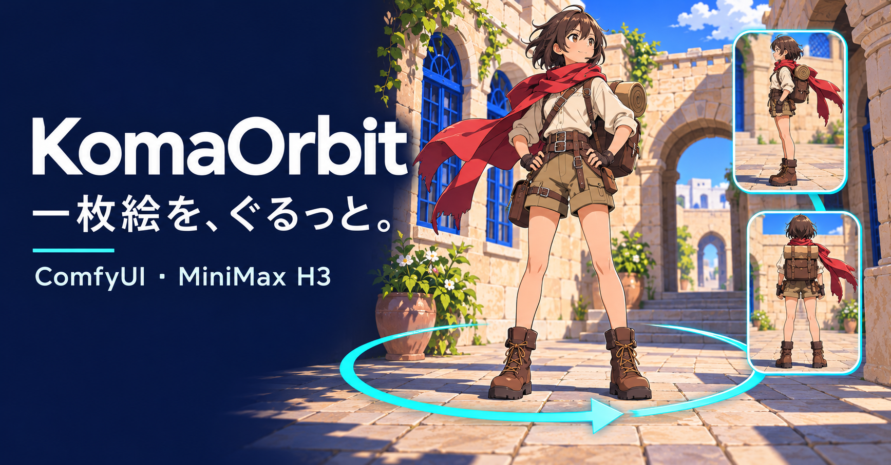
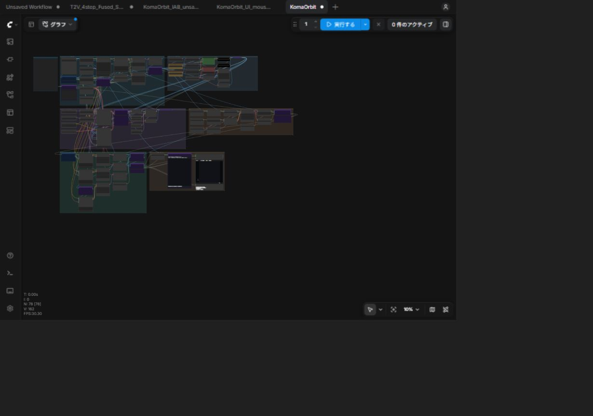
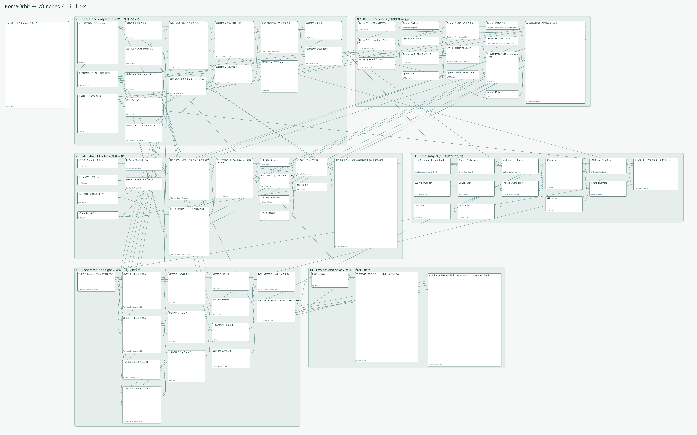
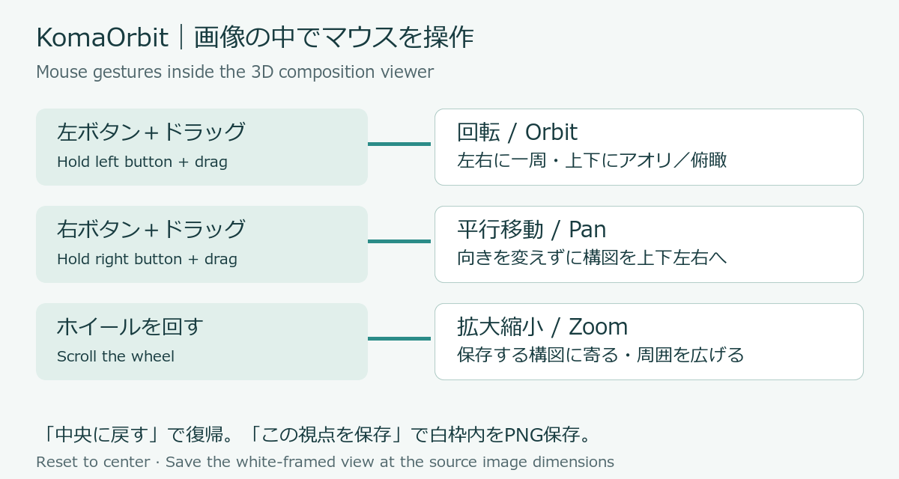

# KomaOrbit — compose an illustration in 3D / 一枚絵から3Dで構図を探す
<!-- bilingual-readme: paired english-japanese -->

[](https://furuyan1234.github.io/comfyui-h3-workflows/komaorbit/demo/)

**[Open the KomaOrbit guide / KomaOrbitの案内ページを開く →](https://furuyan1234.github.io/comfyui-h3-workflows/komaorbit/demo/)**

Concept cover, not a generated scene screenshot. / 紹介用のコンセプト画像で、実行結果の画面ではありません。

KomaOrbit turns an illustration into a fixed 3D subject and an inferred environment in local ComfyUI. Move the camera with the mouse and save your composition at the original image dimensions. / 一枚絵から固定3Dの人物と補完背景を作るローカルComfyUIワークフローです。マウスでカメラを動かし、選んだ構図を元画像と同じ画素数で保存します。

The package contains workflow JSON, custom-node source, installation scripts, tests and notices. Supply your own images and obtain models separately. / 配布内容はワークフローJSON、ノードのソース、導入・検査用スクリプト、権利表示です。入力画像は利用者が用意し、モデルは別途取得します。

## Download / 入手先

Download the named **KomaOrbit_20261105183001.zip** asset from [the KomaOrbit release](https://github.com/FURUYAN1234/comfyui-h3-workflows/releases/tag/komaorbit-20261105183001), then follow Installation below. This repository also distributes other H3 workflows; choose the KomaOrbit ZIP. / [KomaOrbitの配布ページ](https://github.com/FURUYAN1234/comfyui-h3-workflows/releases/tag/komaorbit-20261105183001)で **KomaOrbit_20261105183001.zip** を取得し、下の導入手順へ進んでください。このリポジトリには別のH3ワークフローもあるため、KomaOrbitのZIPを選びます。

[Introduction / 紹介記事](https://note.com/happy_duck780/n/n3f68482d5edd) · [Usage page / 操作・導入ページ](https://furuyan1234.github.io/comfyui-h3-workflows/komaorbit/demo/) · [Model list / モデル一覧](models.json)

## Workflow and input / 実ワークフローと入力例



Actual ComfyUI screen from the clean import. Use the following complete graph to inspect its 78 nodes and 161 links at full size. / 配布物を新規読込した実際のComfyUI画面です。78ノード・161接続の詳細は、次の全体図を拡大して確認できます。



[Open the scalable SVG / 拡大できるSVG](https://raw.githubusercontent.com/FURUYAN1234/comfyui-h3-workflows/main/docs/assets/komaorbit/workflow-map.svg). This graph is drawn from the distributed JSON at its saved positions; it is not an application screenshot. Input/outpainting is at the top left; camera controls and saving are in the lower middle group. / 配布JSONの実ノードと接続を保存位置どおりに描いた構成図で、アプリ画面のスクリーンショットではありません。左上が入力・画像外補完、下段中央が回転・構図・保存です。


This generated monochrome illustration was the input for the recorded normal-path check. It is the 2D source, not a 3D output. / 記録済みの通常経路検証に使った、生成したモノクロの元絵です。3D化後の画像ではありません。

## What you can make / 作れるもの

Start with one illustration. Generate the subject and surroundings once, then move the camera to find a side view, a low or high view, or a closer crop. Save the framed result as a PNG with the same width and height as the input. / 一枚のイラストから人物と周囲を生成し、横から見る、見上げる、見下ろす、顔へ寄るといった構図をマウスで探します。気に入った構図は、入力画像と同じ幅・高さのPNGに保存できます。

Two result panels serve different purposes. The **3D composition viewer** lets you freely orbit, pan and zoom. The **angle-image viewer** lets you select and export a prepared set of views. Their on-screen titles and locations are explained under First generation. / 結果を見る画面は2つあります。**3D構図ビューアー**は回転・平行移動・拡大縮小を自由に操作する画面、**角度別画像ビューアー**はあらかじめ用意した視点の画像を選ぶ画面です。実際の表示名と場所は「最初の生成」で案内します。

| Result / 得られるもの | Use / 用途 |
|---|---|
| Selected-view PNG / 選んだ構図のPNG | Save one composition at the original image dimensions / 元画像と同じ寸法で1枚保存 |
| Angle-image folder / 角度別画像のフォルダー | Export low, level and high views: 73 directions per height, 219 images including the closing 360° view / 低・水平・高の3段階を各73方位、終点360度を含む219枚として一括保存 |
| Gaussian-splat PLY / 3Dデータ | Open the subject in an app with a Gaussian-splat importer / Gaussian Splatの読み込みに対応した3Dアプリで人物を利用 |

The hidden sides and surroundings are AI estimates. Face detail uses the source image, but exact likeness at every viewpoint is not assured. / 見えない面や画像外の背景はAIが推定します。顔には元絵の詳細を反映しますが、どの角度でも同じ顔になることを保証するものではありません。

## Requirements / 必要な環境

- Linux or WSL2, NVIDIA CUDA GPU, Git, Python 3.10+, C++ compiler and CUDA Toolkit matching PyTorch. / LinuxまたはWSL2、NVIDIA CUDA GPU、Git、Python 3.10以上、PyTorchに対応するC++コンパイラー・CUDA Toolkit。
- Recent ComfyUI with MiniMax H3, Qwen Image 2.1, Idol/TripoSplat and Gaussian-splat nodes. See [VALIDATION.md](VALIDATION.md) for exact tested versions. / MiniMax H3・Qwen Image 2.1・Idol/TripoSplat・Gaussian Splat標準ノードを含むComfyUI。検証版は[検証記録](VALIDATION.md)を参照。
- The local GPU is RTX 5080 16 GB; this is a tested configuration, not a guaranteed minimum. Native Windows and macOS are not validated. / 検証GPUはRTX 5080 16GB。最低要件を保証する値ではありません。Windowsネイティブ・macOSは未検証です。
- Sufficient RAM and disk for the models in [models.json](models.json). FL2VA is the normal route; Ref2VA and its LoRA are optional comparison downloads. / [モデル一覧](models.json)の大きなモデルを配置できるRAM・ディスクが必要です。標準はFL2VA。Ref2VA本体とLoRAは比較経路用です。

## Installation / 導入

Use the Python environment belonging to ComfyUI for every command. Activate its virtual environment first. / 以下はすべてComfyUI用のPythonで実行します。仮想環境の場合は先に有効化してください。

1. Extract the named release ZIP and open a terminal in that folder. / Releaseの名前付きZIPを展開し、そのフォルダーでターミナルを開きます。
2. Verify and install all three node packages. / 展開ファイルを検査し、3つのノードパッケージを導入します。

```sh
python verify_package.py
python install.py --comfy /path/to/ComfyUI --dependencies
```

If a node package already exists, back it up before adding `--replace`. The installer does not download model weights or modify user outputs. / 同名ノードがある場合はバックアップしてから`--replace`を付けます。モデル重みの取得や利用者の出力の変更は行いません。

3. Read the [WorldMirror terms](https://github.com/Tencent-Hunyuan/HunyuanWorld-Mirror/blob/c61300e47ce06db2f02c8e2551aae68be7ae3a0b/License.txt), then obtain its official code separately. This explicit command fetches its pinned inference source and license notices. / WorldMirrorの条件を確認して公式コードを別途取得します。次の明示コマンドは指定版の推論コードと権利表示を取得します。

```sh
python /path/to/ComfyUI/custom_nodes/ComfyUI-H3-Orbit/prepare_runtime.py --worldmirror
```

4. Build/check gsplat for your GPU. Point `--cuda-home` at the matching CUDA Toolkit, or omit it if already discoverable. / GPU用のgsplatをビルド・確認します。対応するCUDA Toolkitを指定し、既に検出できる場合は`--cuda-home`を省略します。

```sh
python /path/to/ComfyUI/custom_nodes/ComfyUI-H3-Orbit/prepare_runtime.py --renderer --cuda-home /usr/local/cuda
```

First compilation can take several minutes. The result is cached locally; no machine-specific binary ships in the ZIP. / 初回ビルドには数分かかる場合があり、結果はローカルにキャッシュされます。PC専用バイナリは同梱しません。

5. Obtain the models below, restart ComfyUI, and open `KomaOrbit.json`. / 以下のモデルを配置し、ComfyUIを再起動して`KomaOrbit.json`を開きます。

For a narrow window, use “ビューに合わせる” (fit view), then select a node and press `.` to focus it. / 細い画面では「ビューに合わせる」で全体を表示し、操作するノードを選んで`.`キーで寄せます。

## Model downloads and network access / モデル取得と通信

Each loader has `properties.models` containing the exact name, destination and upstream URL. Use ComfyUI's missing-model Download/Copy URL controls or [models.json](models.json). Save each file under `ComfyUI/models/<directory>/`. / 各ローダーにファイル名・配置先・取得URLを登録しています。不足モデルのDownload／リンクコピー、またはモデル一覧を使い、指定フォルダーへ配置します。

WorldMirror additionally needs [config.json and model.safetensors](https://huggingface.co/tencent/HunyuanWorld-Mirror/tree/main) in `ComfyUI/models/worldmirror/`. Separately downloaded code goes in `custom_nodes/ComfyUI-H3-Orbit/vendor/worldmirror/`. / WorldMirrorは追加で`config.json`と`model.safetensors`を`models/worldmirror/`へ配置します。公式コードは別途取得コマンドにより左記へ入ります。

The first face-restoration run automatically downloads missing hysts detector weights into the standard Hugging Face cache: HRNetV2 revision `9b3435248b26aeb82e2a8578fe9d86d5d57158af`, YOLOv3 revision `afdd4226a79ae8bb81f334dbcffd34f8cc000c38`. / 顔復元の初回は、不足しているhystsの検出用重み2つをHugging Face標準キャッシュへ自動取得します。固定版は左記です。

There is no cloud generation API or API-key requirement. Model/code downloads contact their upstream hosts; image processing is local. / クラウド生成API・APIキーは不要です。モデル・コードの取得時は配布元へ通信し、画像処理はローカルで行います。

## First generation / 最初の生成

In ComfyUI, a **node** is one rectangular block in the workflow. You do not need to edit every block. Start with the image input and the existing defaults, then use the result viewers. / ComfyUIでいう**ノード**は、ワークフロー上に並ぶ四角い部品です。すべての部品を操作する必要はありません。最初は入力画像と配布時の設定を使い、生成後に結果のビューアーを操作します。

### 1. Load an illustration / 画像を読み込む

In the **Input and outpaint / 入力と画像外補完** group near the top, find **「一枚絵を読み込む / Import」** (its title starts with ①). Choose your image using the file-upload control. For a first test, use an illustration with a clearly visible person and face. / 上側の**「入力と画像外補完」**グループにある**「一枚絵を読み込む / Import」**を探し、ファイル選択から画像を取り込みます。タイトル先頭の①は場所を探す目印です。初回は人物と顔がはっきりした一枚絵で試してください。

### 2. Keep the normal generation settings / 標準設定を確認する

The distributed workflow already has these defaults. Check the following labels if you previously changed its settings. / 配布時は次の値になっています。以前に設定を変更した場合は、表示名を目印に確認してください。

| Block title / 画面の表示名 | Setting / 設定 |
|---|---|
| 「画像準備 • 長辺px・縦横比維持」 | Long edge 1024; this is processing resolution / 長辺1024。生成処理に使う解像度です |
| 「背景・上下の視点計画」 | 作成方法 → 「固定3Dを新規生成」 / 新しい画像から3Dを作る設定 |
| 「生成方式 • FL2VA 28steps / 従来20steps」 | 「背景用 FL2VA（73枚）」 / 通常使う周回生成方式 |

Click ComfyUI's **「実行する」** button and wait for generation to finish. The workflow expands the background, generates reference/orbit images, builds the fixed subject and surroundings, and applies face detail. / ComfyUIの**「実行する」**を押し、完了まで待ちます。背景の拡張、参照画像と周回画像の生成、人物と周囲の3D化、顔の詳細反映が順に行われます。

Defaults: H3 28 steps/73 frames; Qwen reference views 4 Lightning steps; background passes 25 steps; Idol 50 steps. / 標準設定はH3が28ステップ・73枚、参照視点のQwenがLightning4ステップ、背景補完が25ステップ、人物生成のIdolが50ステップです。

One isolated test with a 1024×1536 input took **18m03.489s** from execution start to success. This includes model loading and additional compilation; four image-description nodes used cached results. Initial installation, prior renderer setup, input creation and subsequent saves are excluded. It is one measured run, not a per-image promise. / 分離環境で1024×1536の画像を試した際は、実行開始から成功まで**18分03.489秒**でした。モデル読込と実行中の追加ビルドを含み、画像説明の4ノードはキャッシュを使っています。初期導入・事前の描画環境構築・入力作成・後からの保存は含まない、1回の実測値です。

### 3. Find the 3D composition viewer / 3D構図ビューアーを開く

In the lower **Explore and save / 回転・構図・保存** group, find the large image panel titled **「固定3D • 左ドラッグ回転／右ドラッグパン／ホイール拡大縮小」**. Its title starts with ⑩. The buttons **「この視点を保存」** and **「中央に戻す」** sit below it. This guide calls that panel the **3D composition viewer**. / 下側の**「回転・構図・保存」**グループにある、大きな画像表示**「固定3D • 左ドラッグ回転／右ドラッグパン／ホイール拡大縮小」**を探します。先頭の⑩が目印で、下に**「この視点を保存」**と**「中央に戻す」**ボタンがあります。この説明では、この画面を**3D構図ビューアー**と呼びます。

## Mouse controls / マウスで構図を決める



Place the pointer **inside the viewer's image**, then use these gestures. Dragging or scrolling the workflow canvas outside the image operates ComfyUI's workspace instead. / ポインターを**ビューアーの画像の中**に置いて操作します。画像の外でドラッグやホイール操作をすると、ComfyUIの作業画面の移動・拡大縮小になります。

| Gesture / 操作 | Result / 動き |
|---|---|
| Hold left button and drag left/right / 左ボタンを押したまま左右へドラッグ | Orbit around the subject continuously / 人物の周囲を一周し、見る方向を変える |
| Hold left button and drag up/down / 左ボタンを押したまま上下へドラッグ | Change between low and high viewing angles / アオリ・俯瞰へ視点の角度を変える |
| Hold right button and drag / 右ボタンを押したまま上下左右へドラッグ | Pan without rotating; move the composition across the frame / 向きを変えず、画面内の上下左右の位置をずらす |
| Scroll the wheel / ホイールを回す | Zoom the saved composition from 0.5× to 4× / 保存する構図を0.5～4倍で拡大縮小 |
| Click 「中央に戻す」 / 「中央に戻す」を押す | Restore the initial camera and model placement / カメラと人物の配置を初期状態へ戻す |

Camera changes reuse the generated scene; you do not need to run the whole workflow again for each viewpoint. Saving a PNG starts a separate render job in ComfyUI's queue. / 視点を変えるときは生成済みのシーンを使うため、構図ごとにワークフロー全体を再生成する必要はありません。PNG保存は、現在の構図を描画する別の処理としてComfyUIのキューに入ります。

## Save one composition / 気に入った構図を1枚保存する

1. Compose the view inside the **white frame** of the 3D composition viewer. The dimmed area outside the frame will be omitted. / 3D構図ビューアーの**白枠内**に収まるように構図を決めます。暗く表示された枠外は保存されません。
2. Click **「この視点を保存」** under that viewer. Wait until the status says **「保存しました: …」**. / 画像の下の**「この視点を保存」**を押し、**「保存しました: …」**という表示を待ちます。
3. Open the indicated file under **`ComfyUI/output/H3_ORB360/snapshots/`**. / 表示されたファイルを **`ComfyUI/output/H3_ORB360/snapshots/`** から取り出します。

For a 1024×1536 input, this PNG is also 1024×1536. Zooming changes the crop and how much of the surroundings is visible, while output width, height and aspect ratio stay the same. Resizing the node does not set the saved image dimensions. / 入力が1024×1536なら、このPNGも1024×1536です。拡大縮小では写る範囲や人物の大きさが変わり、保存画像の幅・高さ・縦横比は変わりません。ノードの表示サイズを広げても、保存画像の寸法は変わりません。

## Export angle images or 3D data / 角度別画像や3Dデータを取り出す

### Angle-image folder / 角度別画像をまとめて保存

In the same **回転・構図・保存** group, use the other image panel, titled **「固定3D • 背景付き・低／水平／高の全視点」** (title prefix ⑧). This is the **angle-image viewer**. Click **「全視点をフォルダー保存」** to export low, level and high views, with 73 directions for each height. / 同じ**「回転・構図・保存」**グループにある、もう一つの画像表示**「固定3D • 背景付き・低／水平／高の全視点」**（先頭⑧）が**角度別画像ビューアー**です。**「全視点をフォルダー保存」**を押すと、低・水平・高の3段階を各73方位で書き出します。

The 219 files include the closing 360° view. Filenames contain direction, elevation and zoom, such as `方位000.0deg_高さ+00deg_f000_倍率1.000x.png`. The exported images retain the source aspect ratio at the processing resolution; the test produced 682×1023 files from a 1024×1536 input. / 終点360度を含む219枚を保存します。名前には方位・高さ・倍率が入り、例は左記のとおりです。こちらの画像は元絵の縦横比を保った**処理解像度**で、1024×1536入力の検証では682×1023でした。

For an original-size final image, use **「この視点を保存」 in the 3D composition viewer**. / 元画像と同じ画素数の仕上げ画像が必要なときは、**3D構図ビューアーの「この視点を保存」**を使ってください。

### Gaussian-splat PLY / 他の3Dアプリ向けデータ

Use the 3D viewer's built-in download/export control to obtain PLY. This is **Gaussian-splat data**: a collection of colored 3D samples. Choose an application or importer that explicitly supports Gaussian splats. A generic PLY mesh importer may not reproduce it. / 3Dビューアー内のダウンロード・書き出し操作でPLYを取得します。これは色の付いた立体的な点の集まりで表す**Gaussian Splat形式**です。Gaussian Splat対応と明記されたアプリや読込機能を使ってください。一般的なPLYメッシュ用の読込だけでは再現できない場合があります。

It has no rig or editable polygon topology. The exported PLY alone does not contain the external panorama and floor textures. / ボーンや編集用のポリゴン構造は持ちません。また、PLY単体には外部のパノラマ・床テクスチャは含まれません。

## Output folders and reopening / 保存先と後日の再開

| Path relative to ComfyUI / ComfyUIからの相対パス | Contents / 内容 |
|---|---|
| `output/H3_ORB360/snapshots/` | Original-size PNGs saved from the 3D composition viewer / 3D構図ビューアーで保存した元画像寸法のPNG |
| `output/H3_ORB360/exports/` | Angle-image folders and metadata / 方位・高さ・倍率別の一括保存画像と情報 |
| `output/H3_ORB360/<scene-id>/` | Scene information, 3D data, textures and working data / シーン情報・3Dデータ・背景テクスチャ・中間データ |

To reopen a scene with its background, keep the **original image and complete scene folder**. In **「背景・上下の視点計画」**, set 作成方法 to **「固定3Dを開く（3D ID指定）」**. Enter the saved scene ID in the `checkpoint` field of **「人物・服・姿勢を固定した3Dシーン」**, keep the same source image, and run. / 背景込みで開き直すには、**元画像とシーンフォルダー全体**を残します。**「背景・上下の視点計画」**の作成方法を**「固定3Dを開く（3D ID指定）」**に変え、**「人物・服・姿勢を固定した3Dシーン」**の`checkpoint`欄へ保存済みの3D IDを指定します。入力を同じ元画像にして実行してください。

## Troubleshooting and limitations / トラブル対応と制約

- Missing nodes: install all three packages, restart and check the ComfyUI version/import log. / ノード不足は3パッケージの配置・再起動・ComfyUIの版と読込ログを確認します。
- Missing weights: compare filenames and folders with `models.json`. / 重み不足はモデル一覧のファイル名・配置先を照合します。
- Renderer errors: match PyTorch/CUDA Toolkit/compiler, then rerun the renderer setup command. / 描画エラーはPyTorch・CUDA Toolkit・コンパイラーの対応を確認して再ビルドします。
- CUDA out of memory: close other GPU jobs and review resolution/RAM. Lower resolution can lose face detail. / VRAM不足は他のGPU処理を止め、解像度・RAMを見直します。縮小すると顔の詳細も減ります。
- Hidden geometry, lighting and background perspective are inferred. Source-face recovery cannot guarantee exact identity at every angle or recover detail absent from the input. / 隠れた形状・照明・遠近は推定です。顔復元でも全角度の厳密一致や元絵にない詳細は保証できません。
- The lowest camera angle is limited by ground clearance and framing. Background depth uses a panorama/floor approximation. / 最低角度は地面との距離と構図に合わせて制限されます。背景の奥行きはパノラマと床で近似します。

## Credits and terms / クレジット・利用条件

Original KomaOrbit code/workflow: MIT. The T8 adapter includes a GPL-3.0-only ComfyUI compatibility module; ComfyUI-Idol is GPL-3.0 with Apache-2.0-derived portions, and anime-face-detector includes MIT/Apache-2.0 components. Complete source and notices are included. / 独自コード・ワークフローはMIT。T8アダプターの互換部分はGPL-3.0-only、ComfyUI-IdolはGPL-3.0とApache-2.0由来部分、顔検出コードはMIT/Apache-2.0です。対応ソースと権利表示を同梱します。

Models and separately obtained implementations retain their upstream terms, including commercial-use and regional restrictions. This software license grants no additional model/output permissions. / モデル・別途取得する実装には、商用利用・地域条件を含む各配布元の条件が適用されます。本ソフトのライセンスはモデルや生成物に追加の許諾を与えません。

See [THIRD_PARTY_NOTICES.md](THIRD_PARTY_NOTICES.md) for MiniMax H3, pablodawson, MATLOWAI, Tencent, Qwen/Alibaba PAI, Idol/TripoSplat, BiRefNet, hysts/OpenMMLab, Kim2091, Real-ESRGAN, T8mars, ComfyUI, gsplat and Spark. / 各作者・モデル・実装へのリンクはクレジット一覧にまとめています。

## Verification and rebuild / 検証と再構築

[VALIDATION.md](VALIDATION.md) records the tested environment and scope. `verify_package.py` checks all SHA-256 values and rejects missing, changed or extra files. / 検証記録に環境と確認範囲を記載しています。検査スクリプトはSHA-256全件と欠落・変更・余分なファイルを確認します。

```sh
python verify_package.py
python build_release.py /absolute/path/outside-source/KomaOrbit.zip
```

Build from the release tag's `docs/komaorbit/` directory. The builder includes only this source package and does not install dependencies. / Releaseタグの`docs/komaorbit/`から再構築します。このソース配布物だけを対象とし、依存物の導入は行いません。

## Changes / 更新

2026-11-05 illustrated documentation revision: reused the original cover, added the actual workflow, JSON graph, source input and control diagram. / 図入り改訂：既存サムネイル、実画面、JSON全体図、入力画像、操作図を追加。

2026-11-05 documentation revision: explained the image input, two result viewers, mouse gestures and three export formats by purpose and visible labels. Workflow and node code are unchanged from `komaorbit-20261105142122`. / 文書改訂：画像入力・2つの結果ビューアー・マウス操作・3種類の出力を、用途と画面の表示名で説明し直しました。ワークフローとノードのコードは初回配布版と同じです。

2026-11-05 initial source release: fixed subject, face detail, pan/zoom/reset, source-size PNG and runtime setup. / 初回ソース配布：人物固定、顔の詳細、パン・ズーム・中央復帰、元画像寸法PNG、ランタイム導入。
